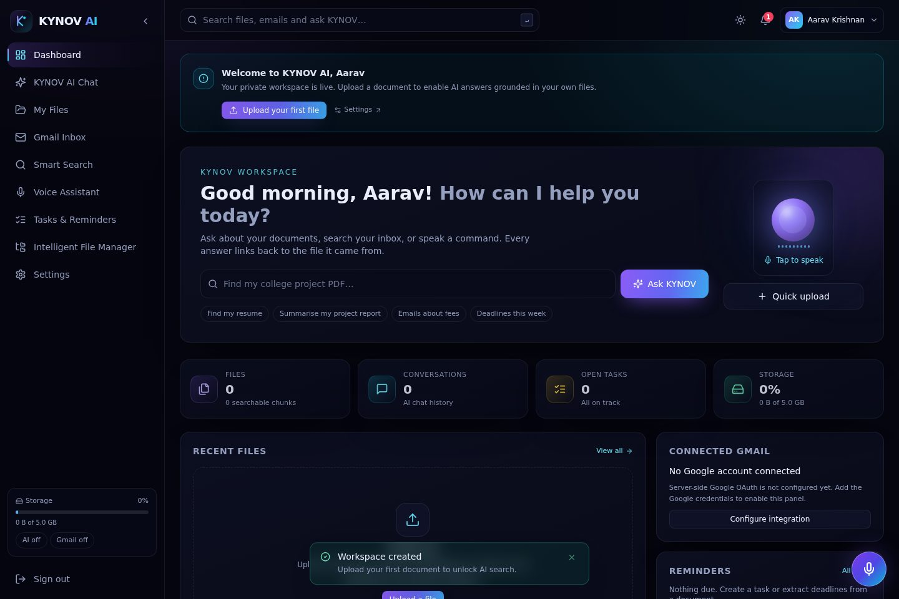
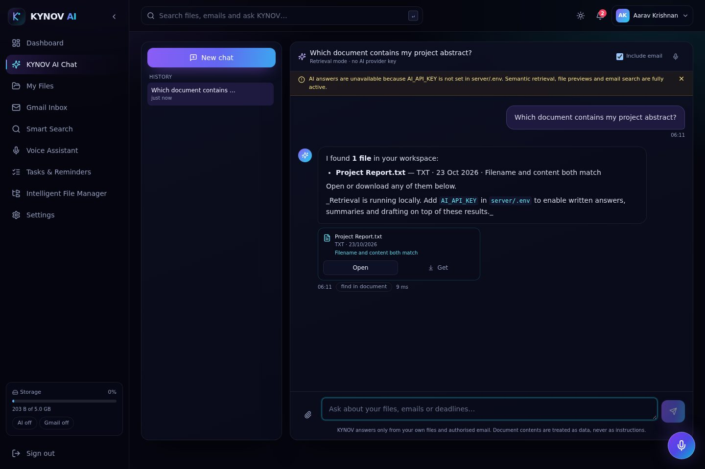
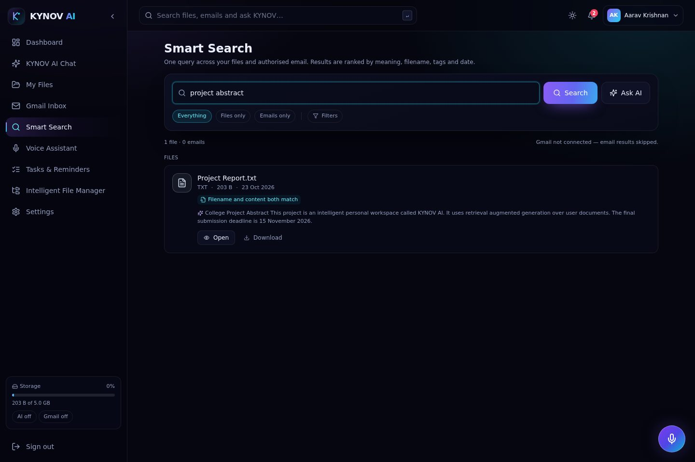
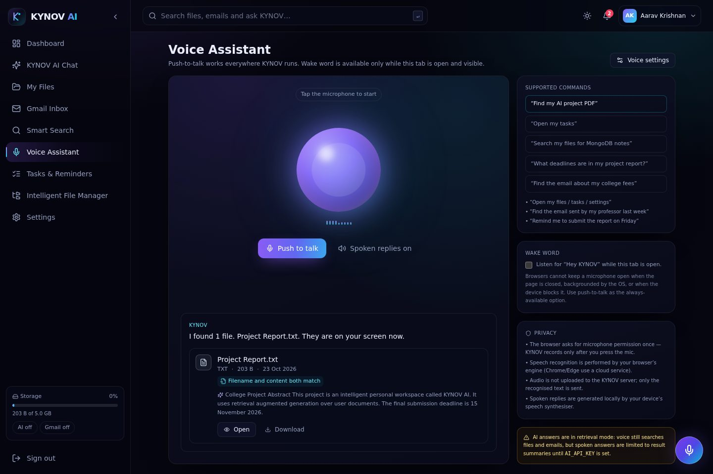
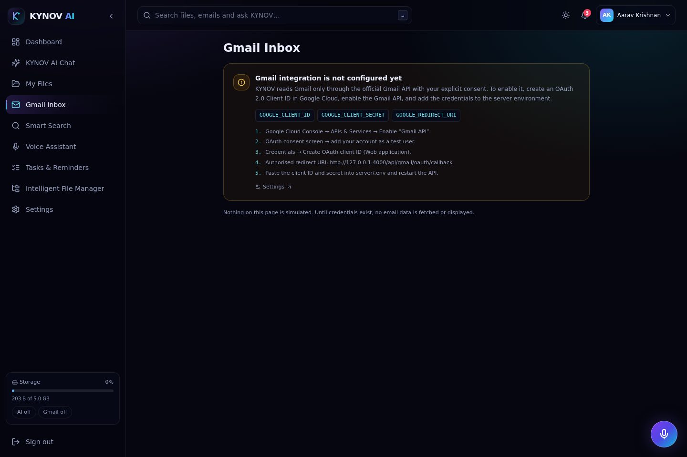
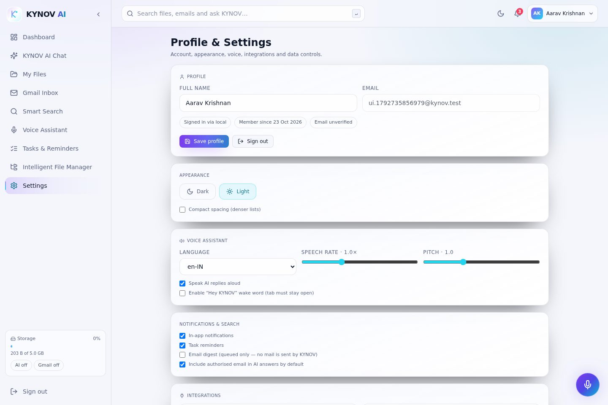
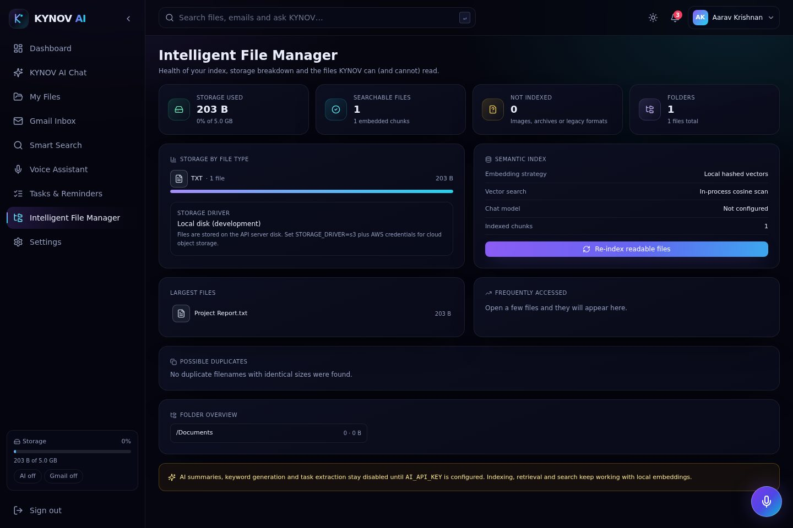
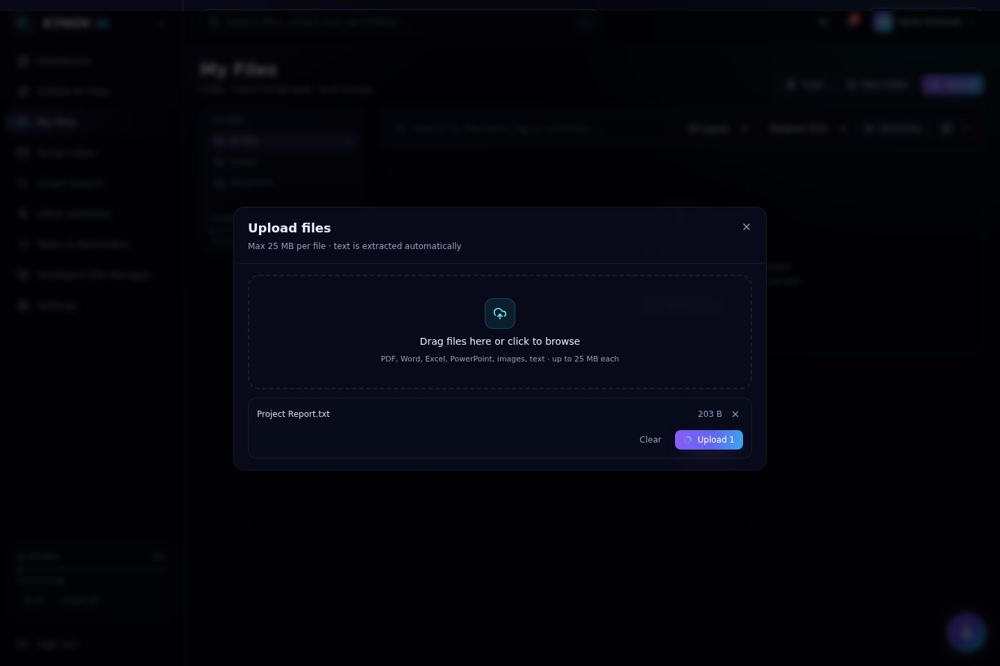

# KYNOV AI — Intelligent Personal Workspace

> Ask about your documents, search your inbox, speak a command. Every answer links back to the file or email it came from.

KYNOV AI is a full-stack, runnable reference application: a React 18 + Vite + TypeScript + Tailwind + Framer Motion client, a Node/Express/TypeScript REST API, MongoDB Atlas + Mongoose, cloud object storage (S3 or local disk), a configurable OpenAI-compatible LLM with embeddings + vector search + RAG, Gmail over Google OAuth 2.0, and a browser Speech Recognition/Synthesis voice assistant.

It is built to be **honest by construction**: every external integration is either genuinely working against your credentials or clearly marked as "not configured" in the UI. There is no mock data, no fake inbox, no fabricated AI answer anywhere in the codebase.

---

## Table of contents

1. [Screenshots](#screenshots)
2. [Feature map](#feature-map)
3. [How integrations behave without keys](#how-integrations-behave-without-keys)
4. [Requirements](#requirements)
5. [Quick start (5 minutes)](#quick-start-5-minutes)
6. [Environment variables](#environment-variables)
7. [MongoDB Atlas](#mongodb-atlas)
8. [Google OAuth 2.0 + Gmail API](#google-oauth-20--gmail-api)
9. [File storage: local or S3](#file-storage-local-or-s3)
10. [AI provider + RAG](#ai-provider--rag)
11. [Scripts](#scripts)
12. [Testing](#testing)
13. [Directory structure](#directory-structure)
14. [API surface](#api-surface)
15. [Security model](#security-model)
16. [Deployment](#deployment)
17. [Troubleshooting](#troubleshooting)
18. [Known limitations](#known-limitations)

---

## Screenshots

Real captures from this build (Playwright, headless Chromium, no mocked responses).

| Dashboard (dark) | AI chat with real file citations |
| --- | --- |
|  |  |

| Smart search across files + email | Voice assistant |
| --- | --- |
|  |  |

| Gmail honest setup state | Settings (light theme) |
| --- | --- |
|  |  |

| Intelligent file manager | My files |
| --- | --- |
|  |  |

---

## Feature map

**Pages (13 routes)**

| Route | What it does |
| --- | --- |
| `/` | Landing page: product story, feature grid, live status strip (AI/Gmail/storage), CTA |
| `/signup`, `/login` | Email + password accounts, optional Google sign-in, strength meter, honest error states |
| `/dashboard` | Greeting, quick ask bar, voice orb shortcut, stat widgets (files, chunks, conversations, open tasks, storage), recent files, suggestions |
| `/chat` | RAG chat: new/rename/delete conversations, history list, answers with matched files (filename, type, reason, date, preview snippet) and Open / Preview / Download actions |
| `/files` | Drag-and-drop upload, grid/list, folders + subfolders, filters (type, folder, date), tags, favourites, sort, bulk actions |
| `/files/:id` | File preview modal/page: text preview, extracted text, AI summary, keywords, chunks, metadata, rename/move/tag/delete/restore |
| `/gmail` | Inbox, message view, attachments, AI summary, task extraction, AI reply draft → confirmed send, disconnect + revoke |
| `/search` | Unified search over files **and** cached email with filters (type, source, folder, date, tags) and per-result provenance |
| `/voice` | Voice orb with mic state, waveform, live transcript, language switch, TTS toggle, stop/interrupt, push-to-talk fallback |
| `/tasks` | Task CRUD with due dates, priorities, status, reminders, AI-suggested tasks that require explicit confirmation |
| `/manager` | Intelligent file manager: storage breakdown, duplicates, stale files, unindexed files, largest files, cleanup suggestions |
| `/settings` | Profile, appearance (dark/light + density), voice prefs, notifications, integrations grid, password change, danger zone, account deletion |
| `*` | 404 |

**Backend capabilities** — every request is authenticated, rate-limited, zod-validated and scoped to the owning user:

- Auth: bcrypt (12 rounds), short-lived access JWT in an `httpOnly` cookie, rotating refresh token, server-side refresh-token hashing, Google Sign-In (optional), password change that revokes all sessions, account deletion (cascade).
- Files: multipart upload via multer (memory → storage driver), MIME + extension + size validation, checksum dedupe, text extraction (PDF, DOCX, XLSX, PPTX, TXT/MD/CSV/code), chunking, embeddings, AI summary + keywords, trash/restore, reindex.
- RAG chat: vector + lexical hybrid ranking, per-file match reasons, explicit "not found" path, prompt-injection hardening (retrieved text is quoted as data, never instructions).
- Gmail: OAuth 2.0 with encrypted (AES-256-GCM) token storage at rest, read/search/view/attachments, AI summary, task extraction, AI draft, **confirmed** send only, disconnect with token revocation.
- Search: one endpoint federating files, cached email and semantic retrieval.
- Tasks + notifications: CRUD, reminders, due-date surfacing, AI suggestions gated behind confirmation.
- Voice: server-side intent parsing of a transcript into search / open / summarize / task actions; the browser does STT + TTS.

---

## How integrations behave without keys

The app boots and is fully navigable with **zero** external configuration. What changes:

| Missing config | Behaviour |
| --- | --- |
| `MONGODB_URI` | Falls back to an embedded ephemeral MongoDB (`mongodb-memory-server`) so you can develop offline. **Data is lost on restart** and the UI shows a "not persisted" notice. |
| `AI_API_KEY` | Chat runs in **retrieval mode**: real chunk retrieval + hybrid ranking + real file citations, but the answer prose is a deterministic extractive summary and the reply carries the notice *"Add `AI_API_KEY` in `server/.env` to enable generated answers."* `GET /api/config` reports `features.ai: false`. |
| `GOOGLE_CLIENT_ID` / `SECRET` | Gmail page shows a setup card listing exactly which env vars are missing, with the redirect URI to register. No inbox is invented. |
| `TOKEN_ENCRYPTION_KEY` | Gmail connect is refused with a clear message — tokens are never stored unencrypted. |
| `STORAGE_DRIVER=s3` without keys | Uploads fail with a precise storage error; the UI surfaces it. Local disk works out of the box. |

`GET /api/config` and `GET /api/meta/features` expose the same feature flags to the client, so any "off" state you see in the UI is derived from the server, not hardcoded.

---

## Requirements

- **Node.js ≥ 20** (built and tested on 20.20.2) and npm ≥ 10
- **MongoDB Atlas** cluster (or local MongoDB; an embedded fallback exists for development)
- Optional: an OpenAI-compatible LLM endpoint, a Google Cloud project with Gmail API enabled, an S3 bucket
- A browser with Web Speech support for the voice page (Chrome/Edge). Safari/Firefox degrade to typing + no wake word.

---

## Quick start (5 minutes)

```bash
# 1. Install root + server + client dependencies
npm install                 # root (concurrently)
npm run install:all         # server/ and client/

# 2. Configure the server
cp .env.example server/.env
#    → edit server/.env (minimum: JWT_ACCESS_SECRET, JWT_REFRESH_SECRET)
#    → paste your Atlas URI into MONGODB_URI, or leave it empty for ephemeral dev DB

# 3. Run both apps
npm run dev
#    API   → http://localhost:4000
#    Client→ http://localhost:5173   (proxies /api to the API)
```

Sign up at `http://localhost:5173/signup`, then upload a PDF/DOCX/TXT from **My Files** and ask about it in **KYNOV AI Chat**.

> If you leave `MONGODB_URI` empty, the server prints `Using embedded MongoDB (development only)`. Everything else works; data disappears when the process exits.

Secrets you can generate right now:

```bash
node -e "console.log(require('crypto').randomBytes(48).toString('hex'))"   # JWT secrets
node -e "console.log(require('crypto').randomBytes(32).toString('base64'))" # TOKEN_ENCRYPTION_KEY
```

---

## Environment variables

All variables live in **`server/.env`** (template committed as `/.env.example` — placeholders only, never real secrets). The client needs nothing beyond an optional `client/.env` with `VITE_API_BASE` (empty in development, where Vite proxies `/api`) and `VITE_PROXY_TARGET` (default `http://127.0.0.1:4000`). A template ships at `client/.env.example`.

### Core

| Variable | Default | Notes |
| --- | --- | --- |
| `NODE_ENV` | `development` | `production` enables secure cookies (with `COOKIE_SECURE`) and stricter CORS |
| `PORT` | `4000` | API port |
| `CLIENT_ORIGIN` | `http://localhost:5173` | Comma-separated allowed browser origins for CORS + cookie checks |

### Database

| Variable | Default | Notes |
| --- | --- | --- |
| `MONGODB_URI` | *(empty)* | Atlas SRV string. Empty → embedded ephemeral MongoDB |
| `MONGODB_DB` | `kynov` | Database name |
| `MONGODB_VECTOR_INDEX` | `kynov_vector_index` | Atlas Vector Search index name; empty/absent → in-process cosine scan |

### Auth / session

| Variable | Default | Notes |
| --- | --- | --- |
| `JWT_ACCESS_SECRET` | *placeholder* | **Change it.** ≥ 32 random chars |
| `JWT_REFRESH_SECRET` | *placeholder* | **Change it.** Different from the access secret |
| `ACCESS_TOKEN_TTL` | `30m` | Access cookie lifetime |
| `REFRESH_TOKEN_TTL` | `30d` | Refresh token lifetime |
| `TOKEN_ENCRYPTION_KEY` | *(empty)* | 32-byte base64 key used for AES-256-GCM of OAuth tokens. Required for Gmail |
| `COOKIE_SECURE` | `false` | Set `true` behind HTTPS |
| `COOKIE_DOMAIN` | *(empty)* | Set when the API and client share a parent domain |

### Google / Gmail

| Variable | Default |
| --- | --- |
| `GOOGLE_CLIENT_ID` | *(empty)* |
| `GOOGLE_CLIENT_SECRET` | *(empty)* |
| `GOOGLE_REDIRECT_URI` | `http://localhost:4000/api/gmail/oauth/callback` |
| `GOOGLE_OAUTH_SUCCESS_REDIRECT` | `http://localhost:5173/gmail` |

### Storage

| Variable | Default | Notes |
| --- | --- | --- |
| `STORAGE_DRIVER` | `local` | `local` or `s3` |
| `LOCAL_STORAGE_DIR` | `./.data/storage` | Local driver root (git-ignored) |
| `MAX_FILE_SIZE_MB` | `25` | Enforced by multer **and** re-checked in the controller |
| `AWS_REGION` | `ap-south-1` | S3 driver |
| `AWS_ACCESS_KEY_ID` / `AWS_SECRET_ACCESS_KEY` | *(empty)* | Prefer an IAM role in production |
| `S3_BUCKET` | *(empty)* | |
| `S3_ENDPOINT` / `S3_FORCE_PATH_STYLE` | *(empty)* / `false` | For MinIO / R2 / Backblaze |

### AI

| Variable | Default | Notes |
| --- | --- | --- |
| `AI_PROVIDER` | `openai` | Label only; any OpenAI-compatible API works |
| `AI_API_KEY` | *(empty)* | Empty → retrieval mode (see above) |
| `AI_BASE_URL` | `https://api.openai.com/v1` | Point at Groq / Azure / OpenRouter / Ollama |
| `AI_CHAT_MODEL` | `gpt-4o-mini` | |
| `AI_EMBEDDING_MODEL` | `text-embedding-3-small` | If embedding calls fail, the deterministic local hash embedder (384-dim) is used and the mode is reported to the client |
| `RAG_CHUNK_SIZE` / `RAG_CHUNK_OVERLAP` / `RAG_TOP_K` | `1100` / `180` / `6` | Chunking and retrieval depth |

### Rate limiting

| Variable | Default |
| --- | --- |
| `RATE_LIMIT_WINDOW_MS` | `60000` |
| `RATE_LIMIT_MAX` | `240` (global, per IP) |
| `AUTH_RATE_LIMIT_MAX` | `20` (auth + AI routes) |

---

## MongoDB Atlas

1. Create a free M0 cluster at <https://cloud.mongodb.com>.
2. **Database Access** → add a user with `readWrite` on `kynov`.
3. **Network Access** → allow your IP (or `0.0.0.0/0` for a demo, and rotate credentials after).
4. **Connect → Drivers** → copy the `mongodb+srv://…` string into `MONGODB_URI` (append `/kynov` or rely on `MONGODB_DB`).

Indexes on `FileChunk.embedding` and the per-collection user indexes are created automatically by Mongoose at boot.

### Optional: Atlas Vector Search (accelerated retrieval)

Without it, KYNOV scores every candidate chunk in-process with cosine similarity (real vector math, bounded to 6 000 chunks per query). With it, retrieval is index-accelerated.

Atlas UI → your cluster → **Atlas Search → Create Search Index → JSON Editor**, database `kynov`, collection `filechunks`, name `kynov_vector_index`:

```json
{
  "fields": [
    { "type": "vector", "path": "embedding", "numDimensions": 384, "similarity": "cosine" },
    { "type": "filter", "path": "user" },
    { "type": "filter", "path": "file" }
  ]
}
```

> `numDimensions` must match your embedding model. `text-embedding-3-small` returns **1536** — either set `numDimensions: 1536` in the index and keep OpenAI embeddings, or set `AI_EMBEDDING_MODEL=` empty to use the 384-dim local model. Mismatches are logged and the server silently falls back to the in-process scan, so nothing breaks.

If the index is missing, you'll see `Atlas vector search unavailable (…); using in-process cosine scan.` in the server log — that is expected and harmless.

---

## Google OAuth 2.0 + Gmail API

KYNOV **never asks for a Google password**. It uses OAuth 2.0 authorization-code flow with a `state` value bound to the session, and requests the minimum scopes.

1. <https://console.cloud.google.com> → create/select a project.
2. **APIs & Services → Library → Gmail API → Enable**.
3. **OAuth consent screen** → External → add yourself as a test user. Add scopes:
   - `openid`, `email`, `profile` (Google Sign-In / identity)
   - `https://www.googleapis.com/auth/gmail.readonly` (inbox, search, attachments)
   - `https://www.googleapis.com/auth/gmail.send` — **only** if you want confirmed sending
4. **Credentials → Create credentials → OAuth client ID → Web application**
   - Authorised redirect URI: `http://localhost:4000/api/gmail/oauth/callback` (and your production equivalent)
5. Copy the client ID / secret into `GOOGLE_CLIENT_ID` / `GOOGLE_CLIENT_SECRET`, set `GOOGLE_REDIRECT_URI` to exactly the registered URI, and set a real `TOKEN_ENCRYPTION_KEY`.
6. Restart the API. The Gmail page now offers **Connect Google** (read-only) and, when send scope is granted, **Enable sending**.

Design notes:

- Tokens are encrypted with AES-256-GCM using `TOKEN_ENCRYPTION_KEY` before they touch MongoDB; they are **never** returned to the client. `GET /api/gmail/status` only reports booleans (connected, scopes, canSend).
- Refresh happens server-side on demand, with a single-flight lock so concurrent requests don't race.
- **Disconnect** calls Google's revocation endpoint and deletes the stored tokens.
- Email bodies are treated as untrusted input: they can be summarised and mined for tasks, but they cannot hijack the assistant into new instructions.
- Email is cached (`EmailCache`) so Smart Search still returns matches (clearly labelled as cached) when the network call fails.

---

## File storage: local or S3

`STORAGE_DRIVER=local` (default) writes objects under `LOCAL_STORAGE_DIR` and streams them back through the authenticated `/api/files/:id/content` endpoint — the browser never gets a filesystem path. Good for a single-host deploy.

`STORAGE_DRIVER=s3` stores objects under `u/<userId>/<fileId>/<originalName>` and serves downloads via short-lived presigned URLs. Works with AWS S3 and any S3-compatible service (`S3_ENDPOINT` + `S3_FORCE_PATH_STYLE=true`).

In both drivers the object key is generated server-side; user-supplied filenames never influence the path.

---

## AI provider + RAG

Any OpenAI-compatible chat-completions + embeddings API works.

```env
# OpenAI
AI_BASE_URL=https://api.openai.com/v1
AI_CHAT_MODEL=gpt-4o-mini
AI_EMBEDDING_MODEL=text-embedding-3-small

# Groq (chat only; embeddings fall back to the local model)
AI_BASE_URL=https://api.groq.com/openai/v1
AI_CHAT_MODEL=llama-3.3-70b-versatile
AI_EMBEDDING_MODEL=

# Local Ollama, no internet required
AI_PROVIDER=ollama
AI_API_KEY=ollama
AI_BASE_URL=http://localhost:11434/v1
AI_CHAT_MODEL=llama3.1
AI_EMBEDDING_MODEL=
```

Pipeline on upload: extract text → split into ~1 100-char overlapping chunks (page numbers preserved) → embed → store in `filechunks` → summarise + keyword-extract.

Pipeline on ask: embed the question → hybrid retrieve (semantic 0.62 / lexical 0.38, top-K 6) → group chunks by file → compose a grounded prompt where retrieved content is delimited as **data** with an instruction to ignore instructions inside it → answer + per-file citations with reason and snippet → if no chunk clears the relevance floor, return an explicit `not found` instead of guessing.

`POST /api/chat/ask` also returns `mode: "ai" | "retrieval"` (plus the model name when one ran) so the UI can be honest about whether an LLM actually answered.

---

## Scripts

From the repository root:

| Command | What it does |
| --- | --- |
| `npm install` | Root tooling (`concurrently`) |
| `npm run install:all` | Installs `server/` and `client/` dependencies |
| `npm run dev` | Runs API (`tsx watch`, `:4000`) and Vite (`:5173`) together |
| `npm run dev:server` / `npm run dev:client` | Run one side |
| `npm run build` | TypeScript build of the server + production Vite build of the client |
| `npm start` | Starts the compiled API (`server/dist/server.js`) |
| `npm test` / `npm run smoke` | 54-check end-to-end API smoke test (see below) |

Inside `server/`: `npm run typecheck`, `npm run build`, `npm start`, `npm run test`.
Inside `client/`: `npx tsc --noEmit` (typecheck), `npx vite build`, `npx vite preview`.

---

## Testing

**API smoke test — 54 assertions, no test framework required:**

```bash
npm run dev:server          # in one terminal (needs nothing but Node)
cd server && npm run test   # in another; BASE_URL defaults to http://127.0.0.1:4000
```

It creates a throwaway user and exercises: health, signup validation + CSRF rejection, session cookie auth, folder + subfolder creation, uploads of a text file and a generated PDF (`pdfkit`), extraction/page counts, indexing, disallowed-extension rejection, listing + content download, smart search with a match reason and a natural-language date filter, chat with real file citations and a declared mode, honest no-match answers, conversation create/rename/load, rename/favourite/move/trash/restore/re-index, storage usage, AI-summary gating without a provider, task CRUD + completion + upcoming, notifications, preferences, Gmail's unconnected-state responses (no fake mail), voice command → real file search, four cross-user isolation checks (a second account gets `404` on another user's file, conversation, search results and delete), logout, and post-logout rejection.

Recent run: **54 passed, 0 failed**.

**Client verification:**

```bash
cd client && npx tsc --noEmit && npx vite build
```

**Browser E2E** (not shipped — Playwright isn't a project dependency): the screenshots above were produced by a 13-step Playwright script covering landing → signup → dashboard → upload → RAG chat citation → search → voice page → task create → Gmail setup state → file manager → settings light/dark → file preview → 390 px mobile layout. 13/13 passed with only two benign pre-login `/api/auth/me` 401s.

---

## Directory structure

```
kynov-ai/
├── package.json                 # root scripts (install:all, dev, build, start, test)
├── .env.example                 # every server env var, placeholders only
├── .gitignore
├── README.md
├── docs/screenshots/            # real UI captures used above
│
├── server/                      # Express + TypeScript API
│   ├── src/
│   │   ├── server.ts            # bootstrap: env → db → http, graceful shutdown
│   │   ├── app.ts               # helmet, cors, cookies, compression, morgan, CSRF, routers
│   │   ├── config/              # env parsing, feature flags, db connect (Atlas or embedded)
│   │   ├── models/              # User, KynovFile, Folder, FileChunk, Conversation,
│   │   │                        # Message, EmailCache, Task, Notification, UserPreference
│   │   ├── controllers/         # auth, files, folders, chat, search, gmail, google,
│   │   │                        # tasks, voice, notifications, preferences, health
│   │   ├── routes/              # router tree mounted at /api
│   │   ├── services/
│   │   │   ├── storage.ts       # local | s3 drivers
│   │   │   ├── extract.ts       # PDF/DOCX/XLSX/PPTX/text extraction
│   │   │   ├── embeddings.ts    # provider embeddings + deterministic local fallback
│   │   │   ├── vector.ts        # chunking, Atlas vector search / in-process cosine
│   │   │   ├── rag.ts           # grounded answering, citations, prompt-injection guard
│   │   │   ├── llm.ts           # OpenAI-compatible chat client
│   │   │   ├── search.ts        # unified file + email search
│   │   │   ├── gmail.ts         # Gmail API, token refresh, send gating
│   │   │   ├── google.ts        # OAuth 2.0 flow, scope handling, revocation
│   │   │   ├── oauthState.ts    # signed, session-bound OAuth state
│   │   │   ├── emailSearch.ts   # email query parsing + cache search
│   │   │   ├── taskExtract.ts   # tasks mined from email/documents (needs confirmation)
│   │   │   ├── authTokens.ts    # JWT issue/rotate/revoke, hashed refresh tokens
│   │   │   ├── notifications.ts # in-app notification fan-out
│   │   │   └── voice.ts         # transcript → intent (search/open/summarize/task)
│   │   ├── middleware/          # auth, csrf, validate (zod), rateLimit, upload (multer), error
│   │   ├── validators/schemas.ts
│   │   ├── utils/               # http, ApiError, asyncHandler, logger, crypto, text, dateParse
│   │   └── scripts/smoke.ts     # the 54-check smoke harness
│   ├── tsconfig.json
│   └── package.json
│
├── client/                      # React 18 + Vite + TS + Tailwind + Framer Motion
│   ├── index.html
│   ├── src/
│   │   ├── main.tsx, App.tsx    # router + providers (auth, theme, toast)
│   │   ├── pages/               # Landing, Signup, Login, Dashboard, Chat, Files,
│   │   │                        # FileDetail, Gmail, Search, Voice, Tasks, Manager,
│   │   │                        # Settings, NotFound
│   │   ├── components/
│   │   │   ├── layout/          # AppLayout, PublicLayout, collapsible Sidebar (9 items), Topbar
│   │   │   ├── files/           # UploadDropzone, FileCard, FileResultCard, FilePreviewModal
│   │   │   ├── common/          # AiOrb, FileIcon, Logo, StatCard, Markdownish renderer
│   │   │   └── ui/              # Modal, ConfirmDialog, EmptyState, SetupNotice, Spinner
│   │   ├── context/             # AuthContext, ThemeContext (light/dark), ToastContext
│   │   ├── hooks/               # useVoice (STT + TTS + wake word), useAsync, useDebounce
│   │   ├── services/            # api.ts (fetch wrapper, CSRF header, 401 refresh) + endpoints.ts
│   │   ├── types/, utils/       # client DTOs; formatBytes/formatDate helpers
│   │   ├── index.css            # Tailwind layers, design tokens, themes, a11y rules
│   │   └── vite-env.d.ts
│   ├── vite.config.ts           # host 0.0.0.0, /api proxy to VITE_PROXY_TARGET
│   ├── tailwind.config.js, postcss.config.js, tsconfig*.json
│   ├── .env.example
│   └── package.json
```

## API surface

All routes are prefixed with `/api`. `requireAuth` (cookie-based) gates everything except `/health`, `/config`, `/meta/features`, `/auth/signup|login|refresh|logout`, `/auth/google/*` and `/gmail/oauth/callback`.

```
GET    /api/health                        liveness + db + feature flags
GET    /api/config                        public runtime config (no secrets)
GET    /api/meta/features                 integration availability

POST   /api/auth/signup | login | refresh | logout
GET    /api/auth/me
PATCH  /api/auth/me
POST   /api/auth/change-password
DELETE /api/auth/me                       (body: { password, confirm: "DELETE" })
GET    /api/auth/google/start | /google/callback

GET    /api/files?query&type&folder&tag&from&to&sort&favourite
GET    /api/files/recent | /storage | /trash
POST   /api/files            (multipart: files[], folderId, tags)
GET    /api/files/:id | /:id/content
PATCH  /api/files/:id        (rename, move, tags, favourite)
POST   /api/files/:id/restore | /:id/reindex | /:id/summarize
DELETE /api/files/:id        (soft delete) ; DELETE /api/files/trash (empty)

GET|POST /api/folders ; PATCH|DELETE /api/folders/:id

GET    /api/chat/conversations ; POST /api/chat/conversations
GET|PATCH|DELETE /api/chat/conversations/:id
POST   /api/chat/message     (persisted turn)  |  POST /api/chat/ask (one-shot)

GET    /api/search?q&type&source&folder&from&to
GET    /api/search/files | /emails | /semantic

GET    /api/gmail/status | /capabilities | /inbox | /search | /cached
GET    /api/gmail/messages/:id | /:id/attachment/:attachmentId
GET    /api/gmail/messages/:id/summary | /:id/tasks
POST   /api/gmail/messages/:id/draft-reply   (draft only)
POST   /api/gmail/send                       (explicit user confirm)
GET    /api/gmail/oauth/start ; POST /api/gmail/disconnect

GET|POST /api/tasks ; GET /api/tasks/upcoming | /suggestions
PATCH|DELETE /api/tasks/:id

POST   /api/voice/command ; GET /api/voice/parse

GET    /api/notifications ; POST /api/notifications/read-all | /:id/read
DELETE /api/notifications/:id
GET|PUT /api/preferences
```

Every response is `{ success, data }` or `{ success: false, error: { code, message, details? } }`.

---

## Security model

- **Passwords**: bcrypt, 12 rounds, never logged or returned. Password change revokes all refresh tokens.
- **Sessions**: short-lived access JWT (`httpOnly`, `SameSite=Lax`, `Secure` in production) + rotating refresh token with a hashed fingerprint stored server-side; logout clears both cookies and revokes the record.
- **CSRF**: each `httpOnly` access cookie is `SameSite=Lax` **and** every state-changing request must carry `X-Requested-With: kynov-web` (a custom header a cross-site form cannot set). The client attaches it automatically; bearer-token API clients are exempt.
- **Authorization**: every Mongoose query is filtered by `user: req.user.id`. Cross-user access returns `404`, not `403`, so resource existence isn't leaked. The smoke test proves isolation with two accounts.
- **Input validation**: zod schemas on body/params/query for every mutating route; unknown keys stripped.
- **Uploads**: MIME allow-list + extension check + size cap + per-user upload rate limit; object keys generated server-side.
- **Rate limiting**: global limiter, a stricter limiter on auth and AI routes, plus upload and search limiters.
- **Hardening**: `helmet` (CSP, HSTS, no-sniff, frameguard), CORS allow-list from `CLIENT_ORIGIN`, `compression`, `morgan` request logs with secrets redacted, centralized error handler that hides stack traces in production, JSON body size cap.
- **OAuth tokens**: AES-256-GCM encrypted at rest, never serialised to the client, revoked on disconnect.
- **Prompt injection**: retrieved document/email text is inserted as delimited untrusted data with an explicit instruction hierarchy; the model cannot call tools or mutate data, and any extracted task requires user confirmation before it becomes a record.
- **Account deletion**: requires password + typed confirmation, then cascades files, chunks, folders, conversations, messages, tasks, notifications, cached email, preferences, tokens and stored objects.

---

## Deployment

**Single host (simplest)** — build once, serve the client's static files behind Nginx or any reverse proxy and run the API:

```bash
npm run install:all
npm run build                     # server/dist + client/dist
NODE_ENV=production node server/dist/server.js   # :4000
# serve client/dist with nginx, proxy /api → http://127.0.0.1:4000
```

Production checklist:

- `NODE_ENV=production`, `COOKIE_SECURE=true`, real `JWT_*_SECRET`s, a real `TOKEN_ENCRYPTION_KEY`
- `CLIENT_ORIGIN=https://your-domain` (exact, no trailing slash)
- `STORAGE_DRIVER=s3` with an IAM role (not long-lived keys) if you run more than one instance
- Atlas IP allow-list narrowed to your egress range; a vector index if you have real volume
- Terminate TLS at the proxy; the API expects to be reached over HTTPS in production

**Split deploy** — API on Render/Railway/Fly (`npm run build` → `node server/dist/server.js`, health check `/api/health`), client on Vercel/Netlify/Cloudflare Pages with `VITE_API_BASE=https://api.your-domain` and CORS/redirect URIs updated to match. The OAuth redirect URI in Google Cloud must equal `GOOGLE_REDIRECT_URI` exactly.

---

## Troubleshooting

| Symptom | Cause / fix |
| --- | --- |
| `Using embedded MongoDB (development only)` | `MONGODB_URI` is empty. Expected for a quick local run; set Atlas for persistence. |
| Chat answers are extractive and carry an "Add `AI_API_KEY`" notice | Retrieval mode. Set `AI_API_KEY` (and `AI_BASE_URL`/`AI_CHAT_MODEL`) and restart. |
| `Atlas vector search unavailable … using in-process cosine scan` | Index missing, wrong name, or dimension mismatch. Harmless; retrieval still works. |
| Gmail page shows the setup card | `GOOGLE_CLIENT_ID`/`SECRET`/`REDIRECT_URI` missing or the OAuth consent screen lacks the test user. |
| `Google connect refused: encryption key missing` | Set `TOKEN_ENCRYPTION_KEY` (32-byte base64). |
| `redirect_uri_mismatch` from Google | `GOOGLE_REDIRECT_URI` must be byte-identical to the URI registered in Google Cloud. |
| Login works, then 401 after ~30 min | Access token expired by design; the client refreshes automatically. If refresh fails, the refresh token was revoked (password change / logout elsewhere). |
| Voice page: "Speech recognition is not supported here" | Firefox/Safari lack `SpeechRecognition`. Use Chrome/Edge; typing and TTS-only still work. |
| No audio in a headless/automated browser | Speech synthesis requires a user gesture and a real audio device — not a bug. |
| `EADDRINUSE :4000` | Another API instance is running: `pkill -f "tsx src/server.ts"`. |
| Server build OOM on a small VM | `NODE_OPTIONS=--max-old-space-size=2048 npm run build` (the scripts already set 2048). |
| Upload rejected with `LIMIT_UNEXPECTED_FILE` | The route expects the multipart field name `files` (repeatable), with optional `folderId`. |

---

## Known limitations

- **Wake word** ("Hey KYNOV") uses the browser Speech Recognition API in continuous mode, so it requires the tab to stay open and focused-ish, needs network in Chrome, and is unreliable in noisy rooms. Push-to-talk is the supported path; the UI says so instead of pretending otherwise.
- Browser STT quality is whatever the browser provides (no server-side Whisper).
- The in-process vector scan is bounded to 6 000 chunks per query; beyond that, create the Atlas index.
- Attachment *uploads* into Gmail drafts are not implemented (drafts are text; existing attachments can be downloaded).
- Browsers cannot render Office binaries natively — the preview shows extracted text plus metadata for DOCX/XLSX/PPTX and inline rendering for PDFs, images and text.

---

Built as a complete, honest reference implementation — every "connected" state in the UI is backed by a real credential check on the server.
